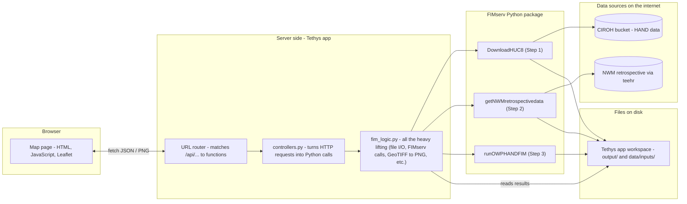

# FIMserv Viewer

**A web app that draws flood maps for any US watershed, for any date between Feb 1979 and Jan 2023.**

Open the app in a browser, click on a watershed, pick a date in that range - and a few
minutes later you'll see exactly which areas would have been under water. You can also
download the result as a GIS file to use in QGIS / ArcGIS.

This app is a web wrapper around [FIMserv](https://github.com/sdmlua/FIMserv), which itself
wraps [NOAA's flood inundation model (HAND-FIM)](https://github.com/NOAA-OWP/inundation-mapping).
It runs on the [Tethys Platform](https://www.tethysplatform.org), which is a free, open-source
framework for hydrology web apps.

> **Deploying from a fresh clone?** See **[RUNBOOK.md](RUNBOOK.md)** (Python pin + AWS CLI checklist).

> **In one sentence:** click watershed → pick date → see flood extent on a map.

---

## What you'll see

When the app is running you get a full-screen Leaflet map. The contiguous US is divided
into ~2,500 small "HUC8" watersheds (HUC = Hydrologic Unit Code; HUC8 means the level-8
naming, roughly the size of a county). Click any one of them, pick a date in the right-hand
sidebar, and the app will:

1. Download terrain and channel data for that watershed.
2. Look up streamflow on that date from the National Water Model (NWM).
3. Compute which pixels would have been flooded.
4. Draw the flooded area as a blue overlay on the map.

You can also:

- Toggle **discharge labels** on each river reach (so you can see "this stream was flowing
  at 91 cfs at that moment").
- Switch the labels between metric (m³/s) and imperial (ft³/s = "cfs") units.
- Click **Download processed (reclassified)** to save a GIS-ready GeoTIFF where flooded
  pixels = 1, dry pixels = 0, and outside-the-domain pixels = NoData.

---

## Some plain-language jargon, just so the rest of this README makes sense

| Term | Plain English |
|------|---------------|
| **HUC8** | A small US watershed (~county-sized). The app shows ~2,500 of them. Each has an 8-digit ID like `06010105`. |
| **NWM** (National Water Model) | NOAA's continuous river-flow forecast/historical record covering every stream in the US. We use the **NWM v3.0 retrospective** (Feb 1979 - Jan 2023). |
| **Discharge / streamflow** | How much water is flowing past a point per second. Measured in m³/s or ft³/s (cfs). |
| **Stage** | How high the water level is in the channel, in metres above the channel bottom. |
| **HAND** (Height Above Nearest Drainage) | A terrain layer that says, for every pixel: "you are X metres above the nearest river." Used to decide if a pixel floods at a given stage. |
| **HAND-FIM** | The flood-inundation model that combines HAND + a per-reach discharge → stage table to produce a flooded-yes/no raster. |
| **Hydrotable** | A pre-made lookup table for each river reach: "if discharge is X, stage is Y." |
| **FIMserv** | A Python package that wraps NOAA's HAND-FIM and the data download steps. This app calls into FIMserv. |
| **Tethys Platform** | The web framework this app runs on. Think "Django + ready-made hydrology UI." |
| **GeoTIFF / .tif** | A raster image file with geographic coordinates. Opens in QGIS or any GIS tool. |
| **GeoJSON** | A JSON file format for geographic shapes (points, lines, polygons). |

---

## Quickstart for macOS / Linux

> Using Windows? Skip down to **[Quickstart for Windows](#quickstart-for-windows)**.

### What you'll need

- A Mac or Linux machine.
- About 5 GB of free disk space.
- A reasonably fast internet connection (the model data is big).
- 30-60 minutes of patience the first time you set this up.
- **Python 3.10, 3.11, or 3.12** in your Tethys conda env (**not 3.13** - see
  [Troubleshooting](#troubleshooting) if install fails mid-way).
- **AWS CLI** for Step 1 (HAND download from the public CIROH S3 bucket). It is
  installed automatically via `install.yml`; verify with `aws --version` after
  `tethys install -d`. No AWS account or credentials are required (`--no-sign-request`).

### Step 1 - Install conda (or mamba)

`conda` and its faster cousin `mamba` are package managers for Python. They let us create
isolated "environments" so installing this app doesn't break any other Python you have.

If you don't already have it, install **Miniforge** (a slim conda that uses conda-forge by
default):

> <https://github.com/conda-forge/miniforge#install>

After installing, close and reopen your terminal so the `conda` command is available.

### Step 2 - Create a Tethys environment and install Tethys Platform

In your terminal, paste these one at a time:

```bash
mamba create -n tethys -c conda-forge \
  "tethys-platform>=4.0" "postgresql" "python>=3.10,<3.13"
```

That makes a new environment called `tethys` and installs Tethys + PostgreSQL + a
supported Python version. **Pin Python here** so `tethys install -d` does not try to
downgrade Python mid-install (which breaks if the env was created with 3.13).

```bash
conda activate tethys
python --version   # should show 3.10.x, 3.11.x, or 3.12.x - not 3.13
```

Your prompt should now show `(tethys)` at the start - that means you're "inside" the new
environment.

### Step 3 - One-time database setup

Tethys uses a small local database (PostgreSQL) to keep track of which apps are installed
and who the users are. You only do this once:

```bash
tethys gen portal_config
tethys db init
tethys db start
tethys db configure
```

That's literally just "make a config file, create the database, start it, set it up."
You'll be asked to create an `admin` user near the end - pick any username + password,
just remember them.

### Step 4 - Get this app

```bash
git clone https://github.com/Aquaveo/tethysapp-fimserve_viewer.git
cd tethysapp-fimserve_viewer
```

### Step 5 - Install the app's dependencies

```bash
tethys install -d
```

This is the slow one - it pip-installs everything declared in `pyproject.toml`
(geopandas, rasterio, **awscli**, FIMserv pinned to a git ref, teehr/pyspark, etc.)
and registers the app with Tethys. Expect several GB of downloads on the first
install. Outside Tethys, a plain `pip install -e .` installs the same set.

Quick sanity checks when it finishes:

```bash
python --version          # 3.10-3.12
aws --version             # AWS CLI present (needed for HAND download)
tethys list               # should include fimserve_viewer
```

### Step 5.5 - Set up the job database (one time)

Background flood-map jobs are tracked in a small app database so their status
survives restarts. For development a sqlite file is all you need - no extra
PostgreSQL setup:

```bash
tethys services create persistent -n fimserve_sqlite -t sqlite -d ~/fimserve_jobs
tethys link persistent:fimserve_sqlite fimserve_viewer:ps_database:jobs_db
tethys syncstores fimserve_viewer
```

Production portals with multiple servers should assign a PostgreSQL service
instead (same commands with `-c <db_user>:<db_password>@<host>:5432` in place
of `-t sqlite -d ...`) so all servers share job state.

### Step 6 - Start the web server

```bash
tethys start -p 127.0.0.1:8001
```

You should see something like:

```
Starting ASGI/Daphne version 4.2.1 development server at http://127.0.0.1:8001/
```

Leave that terminal alone - that's your server. To stop it later, press **Ctrl+C** in
that window.

### Step 7 - Open the app

In your browser, go to:

> **<http://127.0.0.1:8001/apps/fimserve-viewer/>**

You should see the map. Pan around, click a HUC8 polygon - you're done.

### Step 8 - Try generating your first flood map

1. Click any HUC8 polygon (try `06010105` - Upper Tennessee - for a quick test).
2. In the sidebar, set **Date** to something like `2022-04-27`, **Time** to `12:00:00`.
3. Click **Generate Flood Map**.
4. Wait. The first time for any given watershed takes 5-15 minutes because the app has
   to download terrain data. Subsequent generations of the same watershed are fast (~1 min).
5. When it's done you'll get a green "splash!" success message.
6. Click **Show on map** - the flooded area appears in blue.
7. Toggle **Show discharge numbers on map** - labels appear on each river segment.

---

## Quickstart for Windows

The flow is exactly the same as for macOS / Linux - install conda, create a Tethys
environment, install the app, start the server. Only the terminal commands and a couple
of OS conventions differ.

### What you'll need

- Windows 10 or 11.
- About 5 GB of free disk space.
- A reasonably fast internet connection.
- 30-60 minutes for first-time setup.
- Recommended: install **Git for Windows** so the `git clone` command works.
  Get it at <https://git-scm.com/download/win>. After installing, you'll have a
  "Git Bash" terminal - but you can also use Anaconda Prompt or PowerShell.

### Step 1 - Install Miniforge (a slim conda)

Download the Windows installer:

> <https://github.com/conda-forge/miniforge#install>

Pick **Miniforge3-Windows-x86_64.exe**. During install:

- ✅ "Install for: Just Me" (default).
- ✅ Leave the default install location.
- ❌ Don't tick "Add Miniforge3 to PATH" (the recommended way is to use the
  **Miniforge Prompt** from your Start menu instead).

When done, open **Miniforge Prompt** from the Start menu. Every command in the
following steps should be pasted into that window. (The black-and-white prompt should
start with `(base)`.)

### Step 2 - Create a Tethys environment and install Tethys Platform

Same command as on Mac (note the Python pin):

```bat
mamba create -n tethys -c conda-forge "tethys-platform>=4.0" "postgresql" "python>=3.10,<3.13"
```

Then activate it:

```bat
conda activate tethys
python --version
```

Your prompt should change to start with `(tethys)`. Python should be 3.10-3.12.

### Step 3 - One-time database setup

```bat
tethys gen portal_config
tethys db init
tethys db start
tethys db configure
```

This will ask you to create an `admin` user - pick any username + password and remember
them. You'll need the password whenever you log into the Tethys admin panel.

> **Tip:** if `tethys db start` fails saying port 5435 is in use, another Tethys instance
> may already be running in the background. Restart your computer and try again.

### Step 4 - Get this app

Using **Git Bash** (recommended) OR Miniforge Prompt with git installed:

```bat
git clone https://github.com/Aquaveo/tethysapp-fimserve_viewer.git
cd tethysapp-fimserve_viewer
```

If you don't want to install git, you can instead **Download ZIP** from the GitHub
repo's green "Code" button, unzip it, and `cd` into the resulting folder.

### Step 5 - Install the app's dependencies

Make sure your Miniforge Prompt is in the `tethysapp-fimserve_viewer` folder
(`cd` to it if needed), then:

```bat
tethys install -d
```

This is the slow step - 5-15 minutes depending on your internet. Same as on Mac.

### Step 5.5 - Set up the job database (one time)

Same as on Mac - a sqlite-backed store is all development needs:

```bat
tethys services create persistent -n fimserve_sqlite -t sqlite -d %USERPROFILE%\fimserve_jobs
tethys link persistent:fimserve_sqlite fimserve_viewer:ps_database:jobs_db
tethys syncstores fimserve_viewer
```

### Step 6 - Start the web server

```bat
tethys start -p 127.0.0.1:8001
```

When you see `Starting ASGI/Daphne version ... at http://127.0.0.1:8001/` it's running.
**Leave that window open** - that's the server. To stop it, press **Ctrl+C** in that
window.

### Step 7 - Open the app

In your browser go to:

> **<http://127.0.0.1:8001/apps/fimserve-viewer/>**

Then follow Step 8 from the macOS section above to generate your first flood map.

### Windows-specific notes

- **Setting environment variables:** the macOS/Linux instructions sometimes say
  `export FIMSERV_ROOT=/some/path`. On Windows, the equivalent is OS-specific:

  - In **Miniforge Prompt / cmd.exe**:
    ```bat
    set FIMSERV_ROOT=C:\Users\YourName\fimserve_workspace
    tethys start -p 127.0.0.1:8001
    ```
  - In **PowerShell**:
    ```powershell
    $env:FIMSERV_ROOT = "C:\Users\YourName\fimserve_workspace"
    tethys start -p 127.0.0.1:8001
    ```

  Note: a `set` / `$env:` value only applies to the current terminal window. If you
  close the window, you'll need to set it again.

- **Path separators:** Windows uses backslashes (`\`) in file paths. The Python code
  in this app uses `pathlib`, which handles this automatically - but if you're typing
  paths into the terminal, use backslashes (or wrap the path in double quotes).

- **Long path errors:** Windows has a default 260-character path limit that can bite
  you when FIMserv writes deeply nested files. If you hit a "filename too long" error,
  enable Long Path Support:

  1. Press Win+R, type `gpedit.msc`, press Enter.
  2. Go to *Computer Configuration → Administrative Templates → System → Filesystem*.
  3. Enable **Enable Win32 long paths**.
  4. Reboot.

  Alternatively, set `FIMSERV_ROOT` to a short path like `C:\fim` so total path length
  stays under 260 chars.

- **`conda` vs `mamba`:** if `mamba create ...` errors out saying "command not found",
  use `conda create ...` instead. Miniforge usually ships both, but some older
  installers only have conda.

- **Antivirus:** some Windows antivirus tools (especially corporate-managed ones) can
  slow `tethys install -d` to a crawl by scanning every file conda extracts. If your
  install seems stuck for >30 minutes with no apparent progress, try whitelisting the
  Miniforge install directory.

---

## API keys (optional)

Some features need a key. Keys never go in the code (GitHub rejects a push
that contains one); they go in a small text file outside the repo, which the
app reads when it runs:

- macOS / Linux: `~/.fimserve_viewer/keys.env`
- Windows: `C:\Users\<you>\.fimserve_viewer\keys.env`

One key per line, `NAME=value`, no spaces around `=`:

```
MAPBOX_TOKEN=pk....
CIROH_API_KEY=...
```

| Key | What it turns on |
|---|---|
| `MAPBOX_TOKEN` | The Mapbox basemap and the NWM river reaches inside the selected watershed. Without it the map starts on Streets, with no reaches. |
| `CIROH_API_KEY` | Return-period flows (2- to 100-year) drawn on the hydrographs, from the [CIROH NWM API](https://hub.ciroh.org/docs/products/data-management/bigquery-api/) (free for CIROH members; request a key there). Without it the hydrographs have no return-period lines. On a portal it can be the app's `ciroh_api_key` setting instead. |

On macOS / Linux, make the file readable only by you: `chmod 600 ~/.fimserve_viewer/keys.env`.
An environment variable of the same name works too, and wins over the file. To
keep the file somewhere else, set `FIMSERVE_VIEWER_KEYS` to its path.

## Git LFS (for contributors)

This repo ships a 57 MB watershed-boundaries file
(`tethysapp/fimserve_viewer/resources/all_huc8.geojson`) that the map needs in order
to draw every HUC8 polygon in the United States. GitHub shows a yellow warning for any
file over 50 MB, so we use **Git Large File Storage (Git LFS)** to keep the main repo
small and avoid that warning when the file is updated in the future.

> **You don't need Git LFS just to use the app.** A normal `git clone` works fine - the
> file already on `main` will download as a regular file. You only need the steps below
> if you're a **contributor** who plans to *modify or replace* `all_huc8.geojson` (or
> add another large file to `tethysapp/fimserve_viewer/resources/`).

### What is Git LFS, in one sentence?

Git LFS swaps big files in your repo for tiny text "pointer" files, and stores the real
contents on a separate server. Git stays fast, GitHub stays happy, and it's transparent
once it's set up.

### One-time setup (per machine)

**macOS** (Homebrew):

```bash
brew install git-lfs
git lfs install
```

**Windows:**

Download and run the installer from <https://git-lfs.com/>, then in your Git Bash /
Miniforge Prompt:

```bash
git lfs install
```

**Linux** (Debian/Ubuntu):

```bash
sudo apt-get install git-lfs
git lfs install
```

`git lfs install` only needs to run **once per machine** - it adds a small entry to your
global git config that teaches git how to handle LFS files.

### What's already configured for you

The repo's `.gitattributes` file is already set up to send these patterns to LFS:

```
tethysapp/fimserve_viewer/resources/all_huc8.geojson
tethysapp/fimserve_viewer/resources/*.geojson
tethysapp/fimserve_viewer/resources/*.gpkg
tethysapp/fimserve_viewer/resources/*.tif
tethysapp/fimserve_viewer/resources/*.tiff
```

So if you drop a new `.geojson`, `.gpkg`, or `.tif` into the `resources/` folder, it's
automatically tracked by LFS - no extra commands needed on your end.

### Workflow when updating a large file

```bash
# 1. After installing git-lfs once (see above), drop your updated file in:
#    tethysapp/fimserve_viewer/resources/all_huc8.geojson

# 2. Verify .gitattributes is going to send it through LFS:
git check-attr filter -- tethysapp/fimserve_viewer/resources/all_huc8.geojson
# Expected output:
#   tethysapp/fimserve_viewer/resources/all_huc8.geojson: filter: lfs

# 3. Commit normally:
git add tethysapp/fimserve_viewer/resources/all_huc8.geojson
git commit -m "Update HUC8 boundaries"

# 4. Confirm LFS has the file (it should be listed):
git lfs ls-files

# 5. Push:
git push
```

That's it. `git push` will upload the actual file contents to GitHub's LFS storage and
push only a tiny pointer through normal git.

### Tracking a brand-new big file (not already in .gitattributes)

If you add a large file with an extension we don't already track:

```bash
git lfs track "path/to/your/big/file.bin"
git add .gitattributes path/to/your/big/file.bin
git commit -m "Add big file via LFS"
git push
```

The `git lfs track` command appends an entry to `.gitattributes`. **Always commit
`.gitattributes` together with the new big file** so other contributors get the rule.

### Troubleshooting

- **"error: File X is 57 MB; this exceeds GitHub's file size limit of 100.00 MB":**
  the file was committed *before* you ran `git lfs install`, so it's a real blob, not
  an LFS pointer. Reset that commit (`git reset HEAD~1`), make sure
  `git check-attr filter -- <file>` says `filter: lfs`, then re-add and re-commit.

- **`git lfs ls-files` shows nothing after a fresh clone:** that just means the existing
  files on `main` were committed before LFS was enabled - they're regular blobs (which
  is fine, the app still works). Future updates will go through LFS.

- **A teammate cloned and the geojson is a 130-byte text file:** they don't have Git LFS
  installed. Have them run `git lfs install` and then `git lfs pull`.

---

## How a flood map is actually computed (visual)

Here's what happens behind the scenes when you click **Generate Flood Map**. The diagram
reads top-to-bottom; each box is one thing the server does, in order:

```mermaid
flowchart TD
    User([You click 'Generate Flood Map']):::user

    subgraph S1["Step 1 - Download watershed data"]
        direction TB
        T1["Server asks FIMserv: get HAND data for this HUC8"]
        Cloud1[("CIROH cloud bucket - pre-computed HAND for every US watershed")]
        Files1["Saves locally: terrain heights, discharge-to-stage lookup table, river segment shapes"]
        T1 --> Cloud1 --> Files1
    end

    subgraph S2["Step 2 - Get streamflow for your date"]
        direction TB
        T2["Server asks NWM: streamflow on this date for every river segment in this HUC8"]
        Cloud2[("National Water Model - retrospective archive Feb 1979 to Jan 2023")]
        Files2["Saves locally: one discharge value per river segment as a CSV"]
        T2 --> Cloud2 --> Files2
    end

    subgraph S3["Step 3 - Compute the flood map"]
        direction TB
        T3a["For each river segment: look up its discharge"]
        T3b["Look up the matching stage from the hydrotable"]
        T3c["Mark every pixel where HAND height is less than or equal to stage as FLOODED"]
        Files3["Output: a GeoTIFF where each pixel = flooded or dry"]
        T3a --> T3b --> T3c --> Files3
    end

    Display["Server sends a PNG preview to the browser"]:::out
    Map([Flooded area appears in blue on the Leaflet map]):::user

    User --> S1
    S1 --> S2
    S2 --> S3
    S3 --> Display
    Display --> Map

    classDef user fill:#dbeafe,stroke:#1d4ed8,color:#1e3a8a
    classDef out fill:#dcfce7,stroke:#15803d,color:#14532d
```



### The intuition behind step 3 (the actual physics)

Imagine a single river segment in your watershed. We know two things about it:

1. **How much water is in it right now** (from the NWM - the "discharge" in m³/s).
2. **A lookup table** that says: if discharge is X, the water surface is Y metres above
   the channel bottom (the "stage"). This table was pre-computed by NOAA from the
   channel's geometry + Manning's equation.

So we do `discharge → stage`. Now we have a number: "the water is, say, 2.3 metres above
the channel here."

Then we look at the HAND raster for the area around that segment. The HAND raster says,
for every pixel: "you are X metres above the nearest river." So if a pixel says "I am
1.8 metres above the river," and the water is at 2.3 metres, then that pixel is **0.5 m
underwater** → it's flooded.

We do that for every river segment in the HUC8 and stitch the results together. That's
the flood map.

---

## How the app is put together (architecture)

If you're going to modify the code, here's the big picture:



In short: **JavaScript talks to Python via HTTP, Python calls FIMserv, FIMserv pulls cloud
data and produces files, Python reads those files back and sends preview images / GeoJSON
to JavaScript.**

---

## Where files live in this repo

```
tethysapp-fimserve_viewer/
│
├── README.md                  ← you are here
├── install.yml                ← Tethys install config (deps live in pyproject.toml)
├── pyproject.toml             ← packaging metadata + all runtime dependencies
├── .gitignore                 ← what NOT to commit (model outputs, etc.)
├── .gitattributes             ← which big files go through Git LFS
│
└── tethysapp/
    └── fimserve_viewer/
        │
        ├── app.py             ← the app's name, color, URL prefix
        ├── controllers.py     ← every API endpoint (one Python function per URL)
        ├── fim_logic.py       ← all the helper code: file lookups, FIMserv calls,
        │                        reclassification, image generation
        │
        ├── public/            ← static files served as-is
        │   ├── css/main.css   ← all the styling
        │   ├── js/main.js     ← all the JavaScript (Leaflet + UI)
        │   └── images/        ← logos, icon
        │
        ├── resources/
        │   └── all_huc8.geojson  ← bundled HUC8 boundary file (~57 MB)
        │
        ├── templates/
        │   └── fimserve_viewer/
        │       ├── base.html  ← Tethys page skeleton
        │       └── home.html  ← the actual map page
        │
        └── tests/
```

If you want to change something:

| What you want to change             | File to edit                                 |
|-------------------------------------|----------------------------------------------|
| The page layout / sidebar / modals  | `templates/fimserve_viewer/home.html`        |
| Colours, fonts, sizes               | `public/css/main.css`                        |
| Map behaviour, button click logic   | `public/js/main.js`                          |
| What an API endpoint returns        | `controllers.py`                             |
| How the flood map is computed       | `fim_logic.py`                               |
| What gets installed                 | `install.yml`                                |
| The app's display name / colour     | `app.py`                                     |

---

## API endpoints (what the JavaScript talks to)

You don't need this unless you're writing your own client. All endpoints live under
`/apps/fimserve-viewer/`.

| What it does                              | URL |
|-------------------------------------------|-----|
| Health check                              | `GET /api/health/` |
| HUC8 boundary GeoJSON                     | `GET /api/all-huc8-geojson/` |
| Run all 3 steps in one go                 | `POST /api/generate-flood-map/` |
| Run **one** step (1, 2, or 3)             | `POST /api/generate-flood-map/step/{step}/` |
| Run with a custom (user-supplied) discharge | `POST /api/generate-flood-map-custom/` |
| Get a PNG preview of an NWM flood map     | `GET /api/flood-map-preview/nwm/{huc8}/{date}` |
| Get a PNG preview of a custom flood map   | `GET /api/flood-map-preview/custom/{huc8}/{q}` |
| Get per-reach discharge labels (GeoJSON)  | `GET /api/flood-q-labels/nwm/{huc8}/{date}` |
| Download an NWM flood-map .tif            | `GET /api/get-flood-map/{huc8}/{date}?reclass=0\|1` |
| Download a custom-discharge flood-map .tif| `GET /api/get-flood-map-custom/{huc8}/{q}?reclass=0\|1` |
| Get a hydrograph (time series)            | `GET /api/get-hydrograph/{huc8}/{date}` |

POST bodies are JSON like:

```json
{ "huc8": "06010105", "date": "2022-04-27", "time": "12:00:00" }
```

---

## What the "reclassified" download actually does

The raw flood map from NOAA's model is a GeoTIFF where each pixel is an integer "HydroID":

- **positive integer** → flooded by river segment with that HydroID
- **0 or negative** → modelled but not flooded
- **NoData (`-9999`)** → outside the modelled area

That's great for traceability ("which segment caused this flooding?") but bad for normal
GIS use. The **Download processed (reclassified)** button collapses it into:

- **1** → flooded
- **0** → dry (model said so)
- **NoData** → outside the model's coverage (we don't know - *not* the same as "dry")

The collapse is done with a tiny rule table in `fim_logic.py`:

```python
DEFAULT_RECLASS_TABLE = [
    (-999_999_999, 0, 0),       # any HydroID ≤ 0 → 0 (dry)
    (0, 2_147_483_647, 1),      # any HydroID > 0 → 1 (flooded)
]
```

We deliberately keep NoData distinct from 0 so users can tell apart "dry" from
"unknown."

---

## Troubleshooting (fresh clone / clean machine)

### `tethys install -d` fails with Python 3.13 / missing `python3.13` executable

**Cause:** The Tethys conda env was created with **Python 3.13**, but this app's
`install.yml` requires **`python>=3.10,<3.13`**. Conda may try to downgrade Python
*during* `tethys install -d`, leaving the installer pointing at an executable that no
longer exists.

**Fix:** Recreate the environment with a supported Python from the start:

```bash
conda deactivate
conda env remove -n tethys   # or whatever name you used
mamba create -n tethys -c conda-forge \
  "tethys-platform>=4.0" "postgresql" "python>=3.10,<3.13"
conda activate tethys
python --version             # must NOT be 3.13
cd tethysapp-fimserve_viewer
tethys install -d
```

### Generate Flood Map fails at Step 1 - `aws: not found` or missing `branch_ids.csv`

**Cause:** Step 1 runs `aws s3 sync` against the public CIROH HAND bucket. If the
**AWS CLI** is not on `PATH`, the download never starts, `branch_ids.csv` is never
created, and Step 3 fails with no inundation output.

**Fix:**

```bash
conda activate tethys
python -m pip install awscli   # normally installed via pyproject.toml
aws --version
tethys install -d    # re-run if you added awscli after the first install
```

After a successful Step 1 you should see folders under `FIMSERV_ROOT` (default
`/var/tmp/fimserve_viewer`) such as `output/flood_<HUC8>/<HUC8>/branch_ids.csv`.
No AWS account is required - the bucket allows anonymous read (`--no-sign-request`).

### Step 1 succeeds but is very slow

First-time HAND download for a HUC8 is **hundreds of MB** from S3. That is expected.
Later runs for the same HUC8 reuse cached files.

---

## Frequently asked questions

### Why did my first flood map take 10 minutes but the second only took 1?

The first time you generate a map for a watershed, the app downloads ~hundreds of MB of
terrain + channel data from the cloud. Once it's on your disk, it's reused. So:

- First generation in a watershed = slow (download dominates).
- Second generation in the same watershed = fast (just NWM streamflow + the inundation calc).

### Why does some river segment show "104 cfs" but no flooded area, while another nearby shows "92 cfs" with a big flood?

Because rivers have different sizes. A small creek that handles 50 cfs in-channel will
overflow at 92 cfs, whereas a larger river can carry 104 cfs entirely within its banks.
The model uses each segment's individual channel geometry - so the flooding-vs-discharge
relationship is different for every river. This is correct behaviour, not a bug.

### Where do the model outputs end up on my computer?

By default, inside the Tethys app's workspace:

```
~/.../tethysapp-fimserve_viewer/tethysapp/fimserve_viewer/workspaces/app_workspace/
   ├── code/inundation-mapping/      ← NOAA's model code (cloned at first run)
   ├── data/inputs/                  ← NWM streamflow CSVs
   └── output/flood_<HUC8>/          ← terrain + flood map .tif files
```

If you want them somewhere else, set the environment variable `FIMSERV_ROOT`
**before** starting the portal:

```bash
export FIMSERV_ROOT=/somewhere/with/lots/of/space
tethys start -p 127.0.0.1:8001
```

### I edited a Python file and nothing changed.

Python code (`controllers.py`, `fim_logic.py`) does NOT auto-reload. Press Ctrl+C in the
terminal where the server is running, then run `tethys start -p 127.0.0.1:8001` again.

CSS, JavaScript, and HTML files DO auto-reload - just hard-refresh your browser
(Cmd+Shift+R / Ctrl+Shift+R).

### I'm getting "command not found: tethys".

You probably forgot `conda activate tethys`. Your prompt should start with `(tethys)`.

### Apps Library page crashes with "X is not a registered namespace".

That means there's a leftover registration in the database from an app you used to have
installed but no longer do. Open a new terminal, then:

```bash
conda activate tethys
tethys manage shell -c "from tethys_apps.models import TethysApp; TethysApp.objects.exclude(package='fimserve_viewer').delete()"
```

That keeps `fimserve_viewer` and removes orphans. Restart the portal after.

### Can I host this somewhere public?

Yes - Tethys runs anywhere Django + Daphne run. For production you'd want a real
PostgreSQL instance, a real ASGI server (the included Daphne is fine but small), HTTPS,
and you should set proper CSRF tokens on the API instead of using `@csrf_exempt`. That's
beyond this README.

---

## Acknowledgements

- **[NOAA-OWP](https://github.com/NOAA-OWP/inundation-mapping)** - for the open-source
  HAND-FIM flood-inundation model.
- **[CIROH](https://ciroh.ua.edu/)** - for hosting the pre-computed HAND data on a free
  S3 bucket.
- **[FIMserv](https://github.com/sdmlua/FIMserv)** (Surface Dynamics Modeling Lab,
  University of Alabama) - the Python wrapper around HAND-FIM that this app calls.
- **[Tethys Platform](https://www.tethysplatform.org)** (Brigham Young University) - the
  web framework.
- **[teehr](https://github.com/RTIInternational/teehr)** - for retrospective NWM access.

---

## License

This app is a port of an existing Flask viewer; it follows the licensing of its upstream
dependencies. See FIMserv, NOAA-OWP, and Tethys Platform for their respective licenses.
